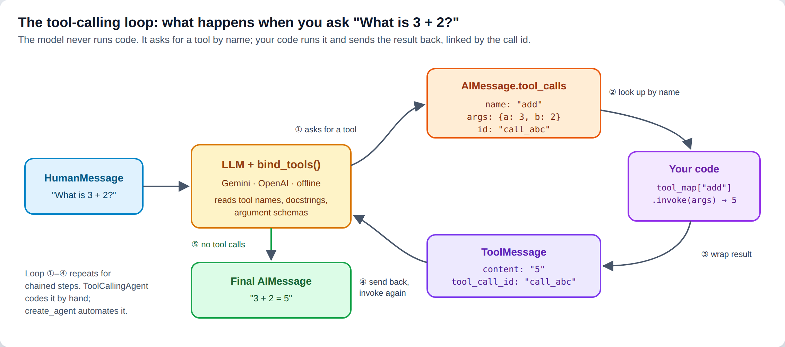
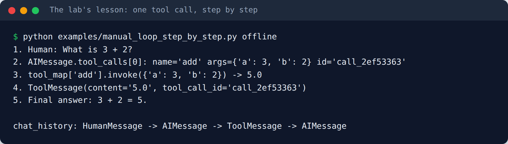
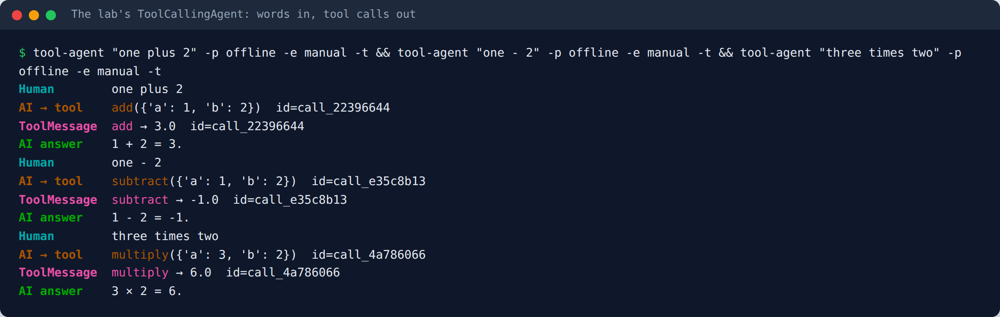
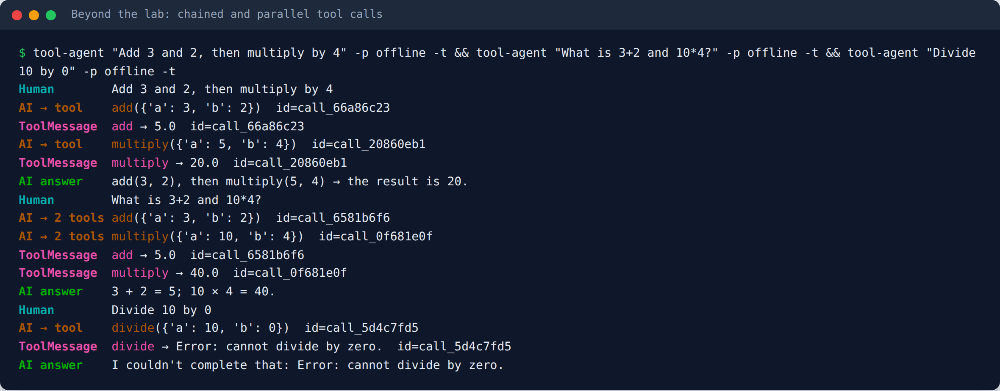
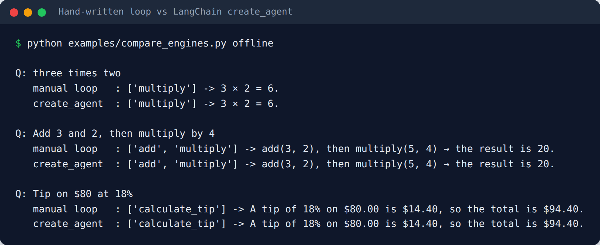
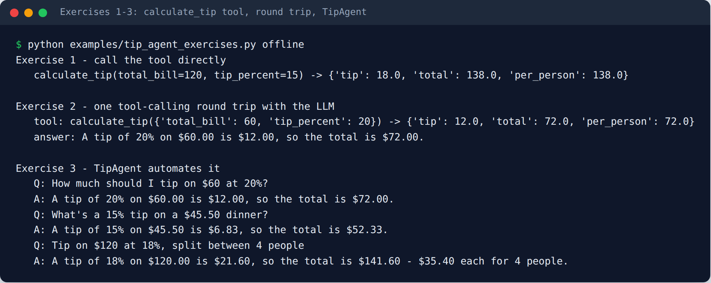
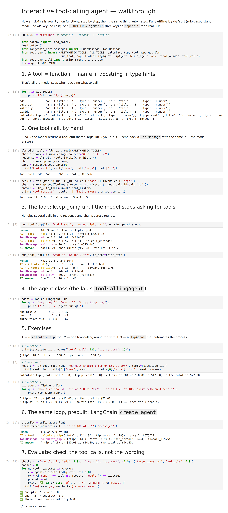
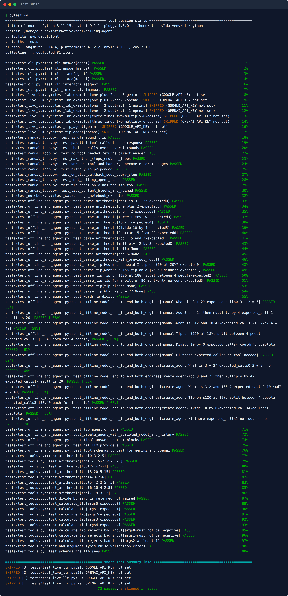
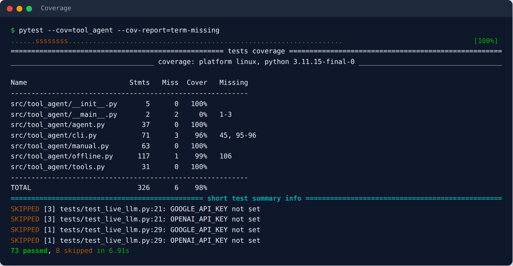

# Interactive Tool-Calling Agent — LangChain

[](https://github.com/<your-user>/interactive-tool-calling-agent/actions/workflows/tests.yml)


How does an LLM actually *call* a Python function? This repo shows the **tool-calling loop by hand**: bind tools → the model asks for one → your code runs it → the result goes back with the call id → the model answers. It then wraps that loop in an agent class and compares it with LangChain 1.x's prebuilt `create_agent`. The example tools are calculator operations and a **tip calculator** (the lab's exercises). It works with **Google Gemini** (free API tier), **OpenAI**, or a built-in **offline mode** that needs no key and costs nothing.

> Portfolio version of the lab *"Build Interactive LLM Agents with Tools"* from IBM's **Fundamentals of Building AI Agents** course (Coursera), re-implemented as a tested, installable package with the exercises solved. See [Credits](#credits).



---

## Contents

- [What the lab asks you to do](#what-the-lab-asks-you-to-do)
- [Features](#features)
- [Quick start (free)](#quick-start-free)
- [How it works](#how-it-works)
- [The exercises](#the-exercises)
- [Usage](#usage) — CLI · Python API · notebook
- [Testing](#testing)
- [Project structure](#project-structure)
- [Configuration](#configuration)
- [Lessons learned](#lessons-learned)
- [Credits](#credits)

## What the lab asks you to do

**The question it answers:** an LLM only produces text. How can it "use" a calculator? The answer is a protocol: the model returns a structured **request** to call a tool, and *your* code executes it.

| Lab step | What you do | Where it lives here |
|---|---|---|
| 1. Define tools | `@tool` functions with type hints and docstrings (`add`, `subtract`, `multiply`) | [`tools.py`](src/tool_agent/tools.py) |
| 2. Bind | `llm.bind_tools(tools)`: the model now knows the tools' schemas | `run_tool_loop` in [`manual.py`](src/tool_agent/manual.py) |
| 3. Ask | put the question in a `HumanMessage` and `invoke` | same |
| 4. Parse | read `response.tool_calls[0]` → `name`, `args`, `id` | same |
| 5. Execute | `tool_map[name].invoke(args)`: look the tool up by name and run it | `run_tool_call` |
| 6. Reply | wrap the result in a `ToolMessage(..., tool_call_id=id)` and append it to the history | same |
| 7. Answer | invoke again with the full history → final `AIMessage` | same |
| 8. Agent class | wrap steps 2–7 in `ToolCallingAgent.run(query)` | `ToolCallingAgent` |
| Exercises | a `calculate_tip` tool, one round trip with it, a `TipAgent` | [The exercises](#the-exercises) |

Every step, printed:



## Features

| | |
|---|---|
| 🔧 **5 typed tools** | add, subtract, multiply, divide, `calculate_tip` (tip, total, per-person split) |
| 🔁 **Manual loop, done right** | handles **several tool calls in one response**, **chains** across rounds, stops after `max_steps` |
| 🧩 **Two engines** | the lab's hand-written `ToolCallingAgent` **and** LangChain's `create_agent`, same tools, same results |
| ⚠️ **Errors as data** | unknown tool, bad arguments, divide by zero → a message the model can explain, never a crash |
| 🔌 **3 providers** | `gemini` (free tier) · `openai` · `offline` (no key, no cost) |
| 💬 **CLI chat** | `tool-agent`, with `--trace` to see every `AIMessage`, `ToolMessage` and call id |
| ✅ **73 tests, 98% coverage** | all offline in CI; live LLM evaluation is opt-in |

## Quick start (free)

```bash
git clone https://github.com/<your-user>/interactive-tool-calling-agent.git
cd interactive-tool-calling-agent
python -m venv .venv && source .venv/bin/activate        # Windows: .venv\Scripts\activate
pip install -e ".[gemini,dev]"

# 1) No key, no cost - offline mode
tool-agent "three times two" -p offline --engine manual --trace

# 2) Real LLM, still free: get a key at https://aistudio.google.com -> "Get API key"
cp .env.example .env          # paste GOOGLE_API_KEY=... (Windows: copy .env.example .env)
tool-agent                    # interactive chat, type 'exit' to quit
```

> **Cost:** offline mode and the tests never call an API. Gemini's free tier has rate limits (a 429 means "retry in a moment"), and Google may use free-tier prompts to improve its models, so keep private data out. OpenAI is billed per token.

## How it works

### 1. A tool is a typed function with a docstring

```python
@tool
def calculate_tip(total_bill: float, tip_percent: float, split_between: int = 1) -> dict[str, Any]:
    """Calculate the tip for a bill, the total to pay, and each person's share.

    Args:
        total_bill: bill amount before tip, e.g. 60 or 45.50
        tip_percent: tip as a percentage, e.g. 20 for 20%
        split_between: number of people sharing the bill (default 1)
    """
```

The name, docstring and type hints become a JSON schema. That schema is what lets the model turn *"tip on $60 at 20%"* into `calculate_tip(total_bill=60, tip_percent=20)`.

### 2. The loop, by hand

```python
llm_with_tools = llm.bind_tools(tools)
messages = [HumanMessage(content=query)]
while True:
    response = llm_with_tools.invoke(messages)
    messages.append(response)
    if not response.tool_calls:                       # no more tools needed
        return response.content
    for call in response.tool_calls:                  # may be several at once
        result = tool_map[call["name"]].invoke(call["args"])
        messages.append(ToolMessage(content=str(result), tool_call_id=call["id"]))
```

That's `run_tool_loop` (plus error handling and a `max_steps` guard). The lab's agent only handled the **first** tool call and **one** round. This version handles the cases the lab mentions but doesn't implement:





| Message | Meaning |
|---|---|
| `Human` | the question (`HumanMessage`) |
| `AI → tool` | the model's request: tool name, arguments, **call id** (`AIMessage.tool_calls`) |
| `AI → 2 tools` | two independent requests in **one** response (parallel tool calls) |
| `ToolMessage` | your code's result, linked by the **same id** |
| `AI answer` | no more tool calls → final answer |

### 3. The same loop, prebuilt

LangChain 1.x's `create_agent` runs exactly this loop for you:

```python
from tool_agent import build_agent, get_llm, ask, final_answer

agent = build_agent(get_llm("gemini"))
print(final_answer(ask(agent, "Add 3 and 2, then multiply by 4")))
```



## The exercises

| # | Task | Solution |
|---|---|---|
| 1 | Create a `calculate_tip(total_bill, tip_percent)` tool and invoke it with 120 / 15 | `tools.calculate_tip`, using `float` instead of the lab's `int` (money has cents), plus total, split and input validation |
| 2 | Bind it, ask *"How much should I tip on $60 at 20%?"*, parse and run the tool call, get the final answer | `run_tool_loop(llm, query, tools=[calculate_tip])` |
| 3 | Automate it as an agent | `TipAgent(llm).run(query)` |



## Usage

### CLI

```bash
tool-agent "one plus 2"                                   # create_agent engine (default)
tool-agent "one - 2" --engine manual --trace              # the lab's hand-written loop
tool-agent "Tip on \$120 at 18%, split between 4 people"
tool-agent -p openai                                      # interactive chat with OpenAI
python -m tool_agent --help
```

### Python API

```python
from tool_agent import ToolCallingAgent, TipAgent, run_tool_loop, get_llm

llm = get_llm("offline")
result = run_tool_loop(llm, "What is 3+2 and 10*4?")
result.tool_calls   # [{'name': 'add', 'args': {'a': 3, 'b': 2}, 'result': '5.0'},
                    #  {'name': 'multiply', 'args': {'a': 10, 'b': 4}, 'result': '40.0'}]
result.answer       # '3 + 2 = 5; 10 × 4 = 40.'

TipAgent(llm).run("How much should I tip on $60 at 20%?")
# 'A tip of 20% on $60.00 is $12.00, so the total is $72.00.'
```

### Notebook

[`notebooks/walkthrough.ipynb`](notebooks/walkthrough.ipynb) goes through tools → one call by hand → the loop → the agent class → the exercises → `create_agent` → evaluating the agent. It runs offline by default.

<details>
<summary>Screenshot of the executed notebook</summary>



</details>

## Testing

```bash
pytest                                            # 73 offline tests, no API keys
pytest --cov=tool_agent --cov-report=term-missing
pytest -m live -v                                 # real-LLM evaluation (GOOGLE_API_KEY / OPENAI_API_KEY)
```

| Test file | What it checks | LLM? |
|---|---|---|
| `test_tools.py` | every tool incl. tip rounding and split, divide-by-zero, input validation, the schemas the model sees | no |
| `test_manual_loop.py` | the hand-written loop with a scripted fake model: message order, call ids, parallel calls, chaining, max steps, unknown tool, bad args, history, callbacks | no |
| `test_offline_and_agent.py` | offline parsing; **both engines** end to end on the same questions; `create_agent` with history; Gemini/OpenAI schema conversion | no |
| `test_cli.py` | answers, `--trace`, interactive chat, for both engines | no |
| `test_notebook.py` | the walkthrough notebook runs top to bottom | no |
| `test_live_llm.py` | a real model picks the right tool and arguments for the lab's examples and the tip question | yes |

**Strategy:** the loop is plain code, so it's tested deterministically with a scripted model that returns exactly the tool calls a real LLM would. Real-model behavior is a separate, opt-in **evaluation** that asserts on *which tool was called with which arguments*, never the wording.





CI runs the offline suite on Python 3.10–3.12. The live job runs on push only for providers whose key is stored as a repository secret.

## Project structure

```
interactive-tool-calling-agent/
├── src/tool_agent/
│   ├── tools.py        # add, subtract, multiply, divide, calculate_tip + tool_map()
│   ├── manual.py       # run_tool_loop, run_tool_call, ToolCallingAgent, TipAgent
│   ├── agent.py        # get_llm() provider switch, create_agent wrapper, helpers
│   ├── offline.py      # rule-based stand-in model (no key, no cost)
│   └── cli.py          # `tool-agent` with --engine manual|agent and --trace
├── tests/              # 73 offline tests + opt-in live evals
├── examples/           # step-by-step loop, exercises, engine comparison, quickstart
├── notebooks/          # walkthrough.ipynb (executed)
├── scripts/            # build_notebook.py, make_screenshots.py
├── docs/images/        # README screenshots
└── .github/workflows/  # CI
```

## Configuration

Copy `.env.example` to `.env`:

| Variable | Default | Purpose |
|---|---|---|
| `LLM_PROVIDER` | `gemini` | `gemini` · `openai` · `offline` |
| `GOOGLE_API_KEY` / `GEMINI_MODEL` | – / `gemini-2.5-flash` | Gemini (free key from AI Studio) |
| `OPENAI_API_KEY` / `OPENAI_MODEL` | – / `gpt-4o-mini` | OpenAI |

Extras: `pip install -e ".[gemini]"`, `".[openai]"`, `".[dev]"`, or `".[all]"`.

### About offline mode

`OfflineToolModel` is **not an LLM**. It's a small keyword-rule model that speaks the same tool-calling protocol (returns `tool_calls` with ids, reads `ToolMessage`s), so the real loop, both agent engines and the real tools run without a key. It understands simple phrasing: `3 + 2`, `one plus 2`, `three times two`, chains with *"then"*, independent parts with *"and"*, and tip questions. For anything open-ended, use Gemini or OpenAI.

All screenshots are real output of the commands shown, generated in offline mode by `python scripts/make_screenshots.py`.

## Lessons learned

- **The model never executes anything.** It returns a request (`name`, `args`, `id`). Your code decides whether and how to run it, which is also where safety checks belong.
- **The call id is the glue.** Each `ToolMessage` must carry the `tool_call_id` it answers, especially when the model asks for several tools at once.
- **Loop until there are no tool calls.** One round isn't enough for *"add, then multiply"*. Always cap the loop with `max_steps`.
- **Handle every call, not just the first.** Models can return parallel tool calls; the lab's agent ignored all but `tool_calls[0]`.
- **Type money as `float`.** The lab's `int` signature rejects `$45.50`. Validation errors should go back to the model, not crash the agent.
- **Small bugs hide in rarely-used branches.** The lab's `response.contet` typo only fails when no tool is needed, and its Exercise 3 solution used globals instead of `self`. Tests for the "no tool" path catch the first.
- **Know the loop, then use the prebuilt.** `create_agent` does the same thing with less code; knowing the manual loop is what makes its traces readable.

## Credits

- Concept and exercises: IBM Skills Network lab *Build Interactive LLM Agents with Tools* (J. Zhou; contributors K. Makwana, K. Goswami), part of **Fundamentals of Building AI Agents** on Coursera. The original notebook is IBM-copyrighted and is **not** included; this repo is an independent re-implementation.
- Built with [LangChain](https://python.langchain.com/) and [LangGraph](https://langchain-ai.github.io/langgraph/).

## License

[MIT](LICENSE) © VictorV
